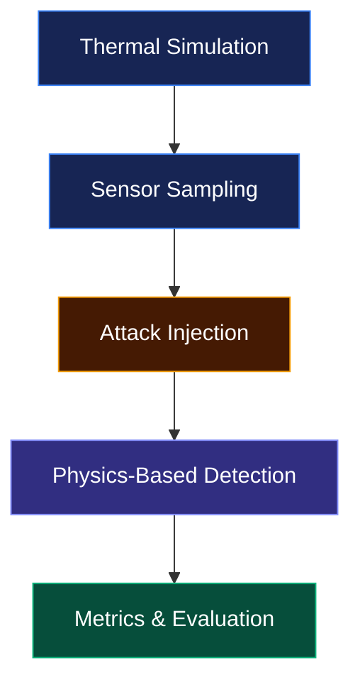

# ThermoShield

<p align="center">
  <strong>Physics-Informed AI for Thermal Sensor Security</strong>
  <br>
  Detección de sensores falsificados mediante modelos físicos de difusión de calor.
</p>

<p align="center">
  
  
  
  
</p>

---

## Overview

ThermoShield explora cómo detectar lecturas de temperatura potencialmente falsificadas en un centro de datos mediante las propiedades físicas de la difusión del calor.

El proyecto simula un campo térmico, genera mediciones de sensores, introduce ataques sintéticos y analiza las inconsistencias para identificar posibles manipulaciones.

## Pipeline



## Architecture Contracts

Las siguientes interfaces están **congeladas**. Las implementaciones deben respetar sus firmas y formatos de salida.

| Function | Contract | Owner |
|:--|:--|:--:|
| `simular(pasos)` | `array [tiempo, y, x]` | A |
| `sample_sensors(malla)` | `DataFrame[t, sensor_id, x, y, temp_medida]` | B |
| `inject_attack(df, tipo, sensor_id, t_inicio)` | `df + es_ataque` | B |
| `detect(df)` | `df + residual, alerta` | A |
| `calcular_metricas(df)` | `dict` | B |

## Workflow

1. Crear una rama por tarea.
2. Implementar sin modificar los contratos congelados.
3. Abrir un Pull Request hacia `main`.
4. Revisar los cambios del compañero antes de integrar.

```text
feature/<task>
      |
      v
 Pull Request
      |
      v
   Review
      |
      v
    main
```

## Project Scope

- Simulación de difusión térmica.
- Muestreo de sensores virtuales.
- Inyección de ataques sintéticos.
- Detección basada en residuos físicos.
- Evaluación mediante métricas.

---

<p align="center">
  <sub>ThermoShield · Physics × AI × Cybersecurity</sub>
</p>